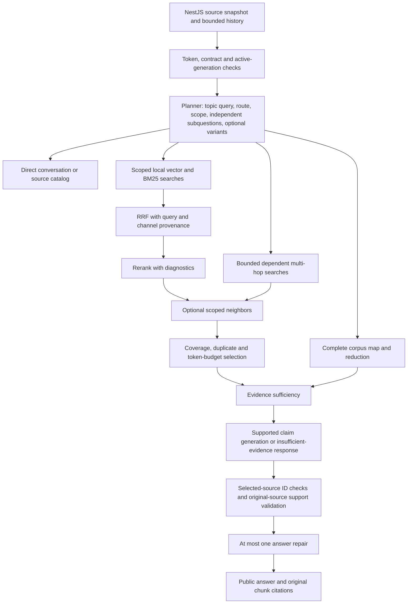

# RAG correctness and debugging

The implementation keeps NestJS as the owner of documents, generations, source snapshots,
conversations, and citations. Python still reads the shared PostgreSQL/pgvector schema and
runs leased ingestion and LangGraph chat. The public `ChatResponse` stays at contract 1.1.0.
`conversationId` is an optional additive request field, supplied by NestJS for correlation.
No schema migration, embedding change, chunker replacement, or reindex is needed.

## Architecture findings

The initial inspection is recorded in [the implementation packet](rag-correctness-plan.md).
The vector repository orders active, source-scoped chunks by cosine distance; lexical search
uses `rank-bm25` over tokenizer tokens from those same active generations. It does not use
PostgreSQL full-text search. RRF uses rank positions with k=60. Reranking uses the generation
provider, not a separate cross encoder, and can retain the strongest fused candidate ahead
of the model's ordering. Generation reads original source text. Search context is separate.

The chunker already provides generation ID, ordinal, original text, page range, heading,
character offsets, and token count. Document identity comes from the generation join. The
worker stores `searchable_text = context_text + original_text` when contextual indexing is
enabled; it preserves the original text. Ingestion leases, heartbeat, staging, and atomic
publication continue to supply the generation boundary for every retrieval query.

The existing corpus processor reads every scoped chunk, validates structured map references,
merges normalized duplicate facts with provenance, and hierarchically reduces document
summaries. Exhaustive lists retain all extracted facts or return a context/output limit error.
It does not compress an exhaustive list into a sampled summary. Complete empty extractions
now render the empty result directly, with scan provenance, without generating an item.



## Root risks and implemented changes

These risks came from code inspection. They are not a measured attribution of production
failures. Use a labeled case and the trace to distinguish them before changing parameters.

The subsequent [live diagnosis and RAGAS comparison](rag-live-benchmark-2026-10-01.md)
found that all expected chunks reached selected evidence on the small fixture. Its dominant
failures were false grounding judgments, malformed JSON, missing-aspect notes, citation
assignment and direct routing. Retrieval depths remained fixed throughout those fixes.

| Risk / previous behavior | Implemented behavior | How it helps |
| --- | --- | --- |
| Scores, per-query matches, fallbacks and stage timings disappeared | One structured request trace, candidate metadata and internal evaluation stages | Locates the first stage that loses expected evidence |
| A follow-up could degrade to its literal question or truncated identifiers | Reuse the bounded planner rewrite; retain precise technical questions and restore exact identifiers | Keeps retrieval tied to the subject and exact names/codes |
| One semantic phrasing determined retrieval | Optional bounded query variants in the planner response; one embedding batch and shared BM25 corpus | Tests alternative vocabulary without changing authorization |
| Depths and the five-result reranker cutoff were constants | Separate vector, lexical, fusion, reranker input/output, and final evidence controls | Measures retrieval depth and reranker loss separately |
| Hybrid BM25 silently sampled 5,000 chunks by UUID | Complete scoped lexical corpus or explicit `CORPUS_LIMIT_EXCEEDED` | Prevents a hidden lexical blind spot |
| Reranker invalid output/truncated excerpts were invisible | Status, input/output counts, actual model ranking, retained strongest candidate, excerpt budget and truncation IDs | Explains whether ranking or a fallback removed evidence |
| Facts could span chunk boundaries | Optional neighbors of top reranked anchors, same document/generation only | Adds missing boundary context with original citations |
| Rank-order selection could repeat text or miss independent aspects | Conservative duplicate checks, per-subquestion coverage, document diversity on relevance ties, required hop anchors, prompt and source token limits | Uses the small evidence budget more deliberately |
| Nonempty evidence triggered generation | Typed complete/partial/insufficient assessment; invalid or truncated assessment stops generation | Separates relevant text from sufficient support |
| A valid citation marker could accompany an invented fact | Structured claims, deterministic selected chunk membership, bounded support judgments against originals, one repair | Rejects invalid IDs and unsupported details before presenting an answer |
| Independent questions could be treated as dependent hops | Separate `subquestions` and dependent `subqueries`; independent searches merge under local retrieval | Gives each independently answerable aspect a retrieval opportunity |
| Exhaustive routing relied on the planner alone | High-confidence English, Thai, Chinese/Japanese, Spanish/French and German signals augment the planner | Sends clear whole-corpus requests to complete scans; ambiguous requests stay with the planner |
| Corpus empty results could be mistaken for absent evidence | Complete empty maps produce a deterministic cited empty result | Avoids inventing a match or rejecting a valid empty list |
| Evaluation showed only two truncated sets | Vector, lexical, hybrid, reranked and selected metrics; trace replay and manual failure JSONL | Supports controlled comparisons and durable regression cases |

Retrieved data, derived notes, histories and answer drafts remain untrusted data. Generation,
sufficiency, reranking and claim validation explicitly forbid following embedded commands.
Scope and citation membership are enforced by application code and active-generation SQL.

## Configuration and defaults

Runtime settings live in `rag_app.config.RagSettings`, inherited by the existing environment
`Settings`. The local and Compose environment examples and Compose service pass-throughs
include these settings. They do not belong in the immutable shared indexing artifact.

| Environment variable | Default | Meaning |
| --- | --- | --- |
| `RAG_QUERY_REWRITE_ENABLED` | `true` | Resolve standalone factual subject in the planner call |
| `RAG_MULTI_QUERY_ENABLED` | `false` | Allow semantic query variants |
| `RAG_MULTI_QUERY_COUNT` | `3` | Original plus at most two variants; range 1–4 |
| `RAG_DECOMPOSITION_ENABLED` | `true` | Allow independently retrievable subquestions |
| `RAG_MAX_SUBQUESTIONS` | `4` | Independent subquestion bound, range 1–4 |
| `RAG_VECTOR_CANDIDATE_LIMIT` | `30` | Vector matches per query, range 1–200 |
| `RAG_LEXICAL_CANDIDATE_LIMIT` | `30` | Lexical matches per query, range 1–200 |
| `RAG_RRF_LIMIT` | `30` | Distinct fused candidates, range 1–400 |
| `RAG_RERANK_LIMIT` | `30` | Candidates shown to the reranker, range 1–100 |
| `RAG_RERANK_RESULT_LIMIT` | `5` | Survivors after reranking; must not exceed its input limit |
| `RAG_NEIGHBOR_EXPANSION_ENABLED` | `false` | Add adjacent original chunks after ranking |
| `RAG_NEIGHBOR_WINDOW` | `1` | Ordinal window on each side, range 0–3 |
| `RAG_NEIGHBOR_TOP_N` | `2` | Top anchors eligible for expansion, range 1–10 |
| `RAG_FINAL_EVIDENCE_LIMIT` | `5` | Local evidence count, range 1–30 |
| `RAG_EVIDENCE_TOKEN_BUDGET` | unset / blank | Optional cap on original source tokens, in addition to the full prompt limit |
| `RAG_SUFFICIENCY_CHECK_ENABLED` | `true` | One bounded coverage judgment before generation |
| `RAG_CLAIM_VALIDATION_ENABLED` | `true` | Require structured claims and validate support against originals |
| `RAG_CLAIM_VALIDATION_MAX_BATCHES` | `8` | Maximum support batches per answer attempt, range 1–16 |
| `RAG_GROUNDING_REASONING_EFFORT` | `low` | Per-call reasoning effort for sufficiency and claim validation |
| `RAG_GROUNDING_MAX_OUTPUT_TOKENS` | `1024` | Total grounding completion budget, including hidden reasoning; range 128–4096 |
| `RAG_ANSWER_REASONING_EFFORT` | `low` | Per-call reasoning effort for grounded generation and its bounded repair |
| `RAG_ANSWER_REASONING_TOKEN_BUDGET` | `512` | Extra completion room for hidden reasoning; visible answer still obeys the indexed output cap |
| `RAG_TRACE_ENABLED` | `true` | Emit one `rag_trace` JSON event per retrieval request, including errors |
| `RAG_TRACE_INCLUDE_TEXT` | `false` | Include question, queries, reason, answer, source/context text and reranker excerpts |
| `RAG_DEBUG_MODE` | `false` | Must explicitly be true before text tracing is accepted |

The maximum local query count is the standalone query plus at most four independent
subquestions and three variants. Expansion does not add a generation call: it shares the
existing planner pass (at most two planner attempts). All local query embeddings share one
provider batch and the lexical corpus is tokenized once. Dependent multi-hop stays capped
at three rounds and uses the same authorized snapshot.

Sufficiency makes one call, with no retry. Sufficiency and support checks use the configured
grounding completion budget (1024 by default), including hidden reasoning. Support checks
batch at most four claims per call. Oversized inputs,
missing verdicts, unknown IDs, invalid JSON and truncation fail validation. An answer gets
at most one generation repair and one additional bounded support pass. A supported partial
answer gets one bounded coverage reconciliation against the originals and validated draft.
Only verified missing aspects receive a specific note, scoped to the supplied evidence.
An insufficient result keeps the existing uncited response shape.

OpenAI grounding and answer calls use native JSON schemas plus local validation. JSON
object mode alone does not guarantee schema adherence; see the official
[Structured Outputs guide](https://developers.openai.com/api/docs/guides/structured-outputs).
The visible answer limit remains the shared index configuration's `maxOutputTokens`.
An added reasoning reserve also counts toward the context budget. The trace's `llm_calls`
records schema use, requested effort, token budgets, completion/reasoning usage and finish
reasons without document text. Literal claim validation accepts only a whole unchanged
original passage; individual paragraphs, substrings, changed quantities and paraphrases still need semantic
checking. Calculation validation receives the question's hypothetical inputs separately
from factual source evidence.

Generation uses short selected-source labels, constrained by its native schema. Application
code maps them to original chunk UUIDs before authorization, claim and citation validation.
Legacy UUID drafts remain readable. The model no longer copies long UUIDs into its answers;
labels never authorize an additional chunk or bypass the source support check.

For a retrieval baseline comparison, leave variants/neighbors off and hold all depths fixed.
The legacy answer format and evidence-presence behavior are available by disabling the
claim and sufficiency settings respectively. Document those switches in an experiment.
Change one retrieval setting per run, pin generation IDs, and compare both source coverage
and latency. Increasing final evidence alone cannot restore a chunk already removed by a
five-result reranker; measure that cutoff independently.

## Evaluation usage

From `llm-backend`, verify the harness without services:

```sh
uv run rag-eval --retrieval-cases evals/datasets/retrieval.example.jsonl \
  --offline --output-dir /tmp/rag-retrieval-report
```

The bundled case is illustrative: its expected chunk survives retrieval and is removed by
reranking. Replace its placeholder document/chunk IDs for a real live evaluation. A manual
JSONL case looks like this (use actual UUIDs and pin their generations when available):

```json
{"question":"How long is the refund period?","expected_answer":"30 days","expected_chunk_ids":["actual-chunk-uuid"],"document_ids":["actual-document-uuid"],"generation_ids":{"actual-document-uuid":"actual-generation-uuid"},"failure_category":"unknown"}
```

Run live retrieval against the existing services:

```sh
uv run rag-eval --retrieval-cases evals/datasets/my-failures.jsonl \
  --backend-url http://localhost:3001 --llm-url http://localhost:8000 \
  --retrieval-mode hybrid --output-dir evals/reports \
  --failure-output /tmp/rag-missing-evidence.jsonl
```

The CLI uses the existing `INTERNAL_API_TOKEN`, resolves ready generation pointers through
NestJS, and calls authenticated `POST /internal/evaluation/retrieval`. That endpoint runs
the same planner/retrieval/reranking/selection code, skipping answer, sufficiency and claim
calls. Corpus routes still prepare complete corpus evidence. A generation pin that no longer
matches fails explicitly. This mode uploads, reindexes and deletes no documents.

Every stage reports Recall@5/10/20/50, MRR, binary NDCG at the same cutoffs, and source
coverage. Ranks deduplicate chunk IDs. With multiple queries, raw vector and lexical stages
aggregate their own per-query rankings using RRF; the hybrid stage combines both channels.
Scores and individual query hits remain available on each candidate. Unmeasured stages in
old failure cases report zero measured cases, rather than an invented recall value. Error
counts and measured case counts are separate. Cutoffs above the configured candidate limit
describe the available set, not an experiment that retrieved additional candidates.

The existing `uv run rag-eval --dataset pipeline_v2` remains available. Its JSON/Markdown
reports now add stage Recall@5/10/20/50, MRR and final source-span coverage, while preserving
the original answer, abstention, citation and latency metrics. Source-span overlap metrics
are approximate; exact chunk-ID cases provide a more direct retrieval regression check.

To replay recorded traces without providers:

```sh
uv run rag-eval --retrieval-cases evals/datasets/my-failures.jsonl \
  --trace-file /tmp/rag-traces.jsonl --output-dir evals/reports
```

A `request_id` pins the trace; otherwise the latest matching question hash is used. Keep
one run's traces together or include request IDs to distinguish identical questions in
different conversations. Replay supports default text-free logs. Save actual rankings
directly with `actual_vector_chunk_ids`, `actual_lexical_chunk_ids`,
`actual_retrieved_chunk_ids`, `actual_reranked_chunk_ids`, and `actual_selected_chunk_ids`
for `--offline` comparisons. Failure categories are validated against the requested scope,
route, rewrite, chunking, retrieval/channel, fusion, reranker, selection, sufficiency,
generation, citation and unknown categories. Automatic hints identify observed retrieval
losses; semantic failure categories still require developer review.

## Investigating one incorrect answer

1. Find `event=rag_trace` using the chat `request_id`; the event also includes the HTTP
   correlation ID and optional conversation ID. Compare authorized scope, effective planner
   scope, active generation IDs and any error code. Check planner status and guardrail first.
2. Confirm the route: exhaustive requests need complete corpus processing; a focused fact
   normally needs local search; independent questions need subquestion coverage. Use the
   internal evaluation response or explicit debug tracing to inspect the standalone query.
3. Look for the expected chunk in vector/lexical candidates and their individual query hits.
   If absent, inspect query terms, parsed original text, chunk boundaries, search context,
   embedding compatibility and lexical corpus limits. Do not change the generation model
   before locating this loss.
4. If the chunk exists in raw retrieval, inspect fused rank and score. If fusion retains it,
   inspect the actual reranker output, excerpt truncation, fallback status, input cutoff and
   retained strongest-result policy. `reranker_score` is null because this ranker returns IDs.
5. If it survives ranking, inspect `evidence_selection` decisions: duplicate, evidence count,
   source token cap, or complete prompt cap. Inspect which neighbors were fetched and retained.
6. Inspect complete/partial/insufficient coverage and missing-aspect count. The model returns
   coverage; application code derives `answerable` so those fields cannot disagree. For rejected
   structured outputs, inspect `sufficiency_schema_errors` / `claim_schema_errors`: these record
   types and sanitized field locations without model/source text. Missing independent
   aspects suggest decomposition or retrieval issues. A false sufficiency judgment is a
   separate failure category, even if some relevant chunks were selected.
7. When final evidence covers the question, inspect claim support outcomes, invalid IDs,
   truncation and repair. Citations must refer to supplied original chunks; a valid citation
   ID alone is not semantic evidence that the claim is true.
8. Add the question, gold chunk IDs, generation pins, observed stage IDs and confirmed category
   to a JSONL failure file. Re-run it before and after one change and retain the report.

Normal logs contain IDs, ranks, scores, hashes, counts and enums; they omit questions, source
names/headings, rewritten queries, missing-aspect text, document/context text and answers.
For a development session set both `RAG_DEBUG_MODE=true` and `RAG_TRACE_INCLUDE_TEXT=true`.
The authenticated evaluation endpoints are not forwarded through the public NestJS chat API.
The service initializes the same JSON-message logging convention as the worker when the host
has not configured logging. Request failures and timeouts still finish a trace. Timing keys
include planner, query rewrite, vector, lexical, fusion, reranking, neighbors, selection,
sufficiency, generation, claim validation, citation validation, and total. Rewrite semantics
run within planner time; `query_rewrite` measures deterministic query preparation. Node times
can include nested validation time, so summing every timing does not equal total latency.

## Important files

- `generation/chat.py`: graph nodes, request observation, optional retrieval-only execution.
- `config.py`, `.env.example`, root `.env.compose.example`, `compose.yaml`: validated runtime
  controls and container pass-throughs.
- `models.py`, `api/chat.py`, `openapi.json`, NestJS generated client: additive internal
  diagnostics and evaluation contract; unchanged public answer schema.
- `retrieval/tracing.py`, `retrieval/hybrid.py`, `repositories/retrieval.py`: safe trace events,
  scored/query-aware fusion, complete lexical reads, active-generation neighbor SQL.
- `retrieval/evidence.py`, `generation/prompts.py`: coverage, conservative duplicates, source
  ordering, evidence budgets and original-text prompts.
- `generation/intents.py`, `query_rewriting.py`, `reranking.py`: typed planning enhancements,
  routing guardrails, exact-term handling and visible reranker policies.
- `generation/grounding.py`, `answers.py`, `corpus.py`: sufficiency, claim source validation,
  structured rendering and deterministic complete empty extraction.
- `evals/retrieval.py`, `evals/runner.py`, example JSONL and `tests/unit/test_rag_*`: evaluation,
  replay, failure cases and regression coverage.

## Verification and limits

The original suite passed 69 tests before changes, using test-only model environment values
because this workspace's local `.env` has blank model names. Added tests cover rewriting,
identifier preservation, query batching/deduplication and scores, scope rejection, independent
decomposition, neighbor bounds/order/budgets, conservative duplicates, all coverage outcomes,
invalid/unsupported claims and repair, prompt injection instructions, corpus empty results,
multilingual routing, safe/disabled/verbose traces, API isolation and retrieval metrics.
Existing full-corpus, multi-hop, follow-up, schema and provider tests remain in the regression
run. The legacy graph tests explicitly retain baseline flags; dedicated graph tests exercise
the new default grounding safeguards.

Final verification: 117 Python tests and 9 NestJS tests passed. Ruff formatting/lint,
the NestJS build/typecheck, OpenAPI export/client generation, Compose configuration and
`git diff --check` passed. The illustrative offline retrieval CLI produced stage metrics
and correctly identified the saved reranker failure. Full Pyright remains nonzero with
118 existing diagnostics in providers and evaluation code, compared with 122 at the
pre-change baseline; no new diagnostics remain in the changed RAG modules.

Live benchmark reporting also counts false abstentions and answerable answer rate separately
from request/metric errors. Insufficient-evidence replies score zero answer token F1. The
grounding prompts include the exact validated JSON schemas; the model's coverage enum is
the sole sufficiency decision, with answerability derived deterministically in code.
See the [2026-10-01 live benchmark](rag-live-benchmark-2026-10-01.md) for measured results,
the grounding regressions it exposed and the remaining failures. Its five-chunk corpus
does not discriminate retrieval depths, and its answer quality remains incomplete.

Semantic judgments still use the configured provider and can be wrong. Extra bounded calls
increase latency and use the existing overall deadline. Corpus limits and supported context
limits remain explicit. No live-provider relevance or answer-quality improvement is claimed
from unit tests or the illustrative replay. Use the pinned failure dataset for that decision.
The shared tokenizer may differ from a hosted generation model's tokenizer; prompt token
counts follow the existing reviewed tokenizer rather than adding another dependency.
