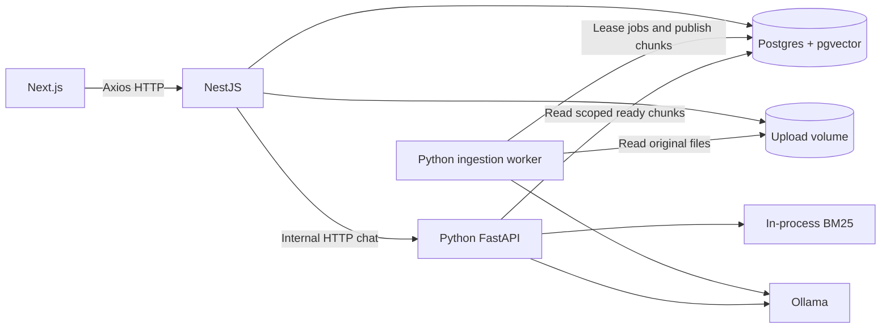

# File chat RAG MVP — implementation plan

Status: draft pending hardware, file/language, and user-scope answers. Planning only; no application implementation yet.

## Goal and provisional scope

Upload documents, see ingestion progress, select ready documents, ask follow-up questions, and receive answers with clickable source excerpts. Apply the approach in [the learning guide](../materials/rag-learning-guide.md): baseline vector retrieval, contextualize chunks during ingestion, add BM25 and rank fusion, and evaluate each increment.

Proposed defaults, subject to confirmation:

- Local single-user application, saved conversations, selected-files or all-files chat.
- Text PDFs, UTF-8 TXT, and Markdown. Scanned/encrypted PDFs receive an actionable error; OCR, DOCX, tables/images interpretation, and web crawling are deferred.
- Initial guardrails: 20 MB/file, 100 files, 5,000 chunks total. Extracted-token limits are separate and depend on the chosen model context budget.
- Show upload, queued, processing, ready, and failed states; allow retry and deletion.
- Non-streaming answers first, with a visible generation state and request timeout. Streaming is an optional subsequent slice.
- No public deployment until authentication and per-user data isolation are designed.

## Decisions still needed

1. Runtime machine: OS, RAM, GPU/VRAM, and whether a host inference service is acceptable.
2. Required file formats, languages (especially Thai), typical document length, and corpus size.
3. Local single-user versus shared authenticated use; any must-have streaming requirement.

These affect model choice, tokenization, document limits, deployment, and data access. Do not freeze their implementation before answers arrive. Continue architecture and contract planning independently.

## Stack and responsibility boundaries

| Layer | Proposed choice | Responsibility |
| --- | --- | --- |
| UI | Next.js App Router, TypeScript, shadcn/ui, Tailwind | Library, uploads, chat, citation drawer |
| Client data | Axios, TanStack Query | Typed API access, mutations, job-status polling, cache invalidation |
| Product API | NestJS, TypeORM | Validation, file storage, document/job records, conversations, public API |
| AI API + worker | Python, FastAPI, Pydantic, psycopg, pgvector Python | Parsing, chunking, contextualization, embeddings, retrieval, answers |
| Storage | PostgreSQL + pgvector | Metadata, durable ingestion jobs, chunks, embeddings, messages |
| Lexical retrieval | Python rank-bm25 | BM25 over scoped original text plus generated context |
| Inference | Ollama | Local generation and embedding models |
| Files | Shared Docker volume | Original uploads; NestJS writes, Python reads |
| Tooling | pnpm workspace for TS; uv for Python; Docker Compose | Reproducible local development |

Keep the existing three top-level service directories. Avoid an additional vector database, Redis, or orchestration framework for this scope. Python owns explicit pipeline functions, making the learning steps visible.

TypeORM is the sole schema/migration owner, including vector tables and SQL extensions. Python uses explicit repository SQL against that schema, not an independent migration system. NestJS owns product writes; Python owns chunk/index writes and leased job progress. Define these exceptions explicitly in the database contract.

Suggested model candidates: `qwen3:4b` for answers and contextualization; `qwen3-embedding:0.6b` for embeddings. These are starting candidates, not a hardware or quality guarantee. Record exact model digest, output dimension, tokenizer/configuration, and prompt version. Pin the embedding dimension in the migration after a probe. Changing embedding models requires full reindexing; never mix embedding spaces.

Docker profiles: CPU Ollama as the portable default, GPU override where supported, and optional host Ollama for Apple Silicon. Model downloads require initial network access; application inference can then stay local. Model weights alone do not represent total RAM needs.

## Architecture



Only NestJS is the browser's backend. Python and Ollama stay on the internal network. The worker and FastAPI use the same Python image with different entrypoints. Durable PostgreSQL jobs avoid losing work when a request ends or the worker restarts.

## Upload and ingestion

1. NestJS validates byte size, extension, and detected type; stores uploads under generated IDs, never user paths. Write via a temporary file and clean up storage if record creation fails.
2. Commit the document and queued job together, then return HTTP 202. Use content hashes to detect accidental duplicate uploads.
3. One worker leases a job using `FOR UPDATE SKIP LOCKED`, commits the lease, then processes outside the transaction. Heartbeat and lease expiry permit recovery; retries are bounded with recorded errors.
4. Parse with pypdf for text PDFs and dedicated TXT/Markdown loaders. Preserve page/heading and source offsets. Reject empty extraction and unsupported PDFs clearly.
5. Split along headings/paragraphs with an initial target of 400–600 tokens and 50–100 overlap. Preserve source spans across page boundaries; all values are tunable.
6. Baseline mode embeds original chunks. Contextual mode generates approximately 50–100 context tokens from the full document and each chunk, then embeds `context + original`.
7. Check the full prompt budget before contextualizing: source + chunk + instructions + output must fit the configured model window. Reject over-budget contextual ingestion with an explicit error in the MVP. A later section-context mode must be identified as a deviation from full-document contextualization; never silently truncate.
8. Stage chunks under a new indexing generation. Publish that generation and mark ready atomically only after all chunks succeed. Partial generations are never searchable.
9. Reindexing keeps the previous generation active until the replacement is complete. Model, chunker, and contextualizer configuration are recorded per generation.

Deletion first makes the document unavailable to retrieval, cancels jobs, then removes original files and index rows. Workers must verify generation/cancellation state before publication to prevent deleted documents reappearing. Existing citations display “source deleted”; retain identifiers but remove saved source excerpts if deletion promises content removal.

## Retrieval and answering

1. NestJS validates the conversation and document selection. Empty explicit selection is an error; `all` is a separate scope value. Resolve active ready document generations.
2. For follow-ups, Python may rewrite the question using a bounded conversation history. History helps resolve references; it is not factual evidence.
3. Embed the query using the indexed embedding model and its prescribed query formatting. Retrieve up to 30 vector candidates with document/generation filters applied in SQL.
4. Load only scoped active chunks for BM25, using the same tokenizer for queries and corpus. Initially rebuild per request under the small corpus cap; optimize with a generation-aware cache only when measurements justify it. Thai requires a language-aware tokenizer and dedicated evaluation.
5. Retrieve up to 30 BM25 matches; discard zero-match candidates. Fuse by chunk ID using `sum(weight / (60 + rank))`, starting with equal weights. Keep roughly 5–8 chunks within the answer token budget.
6. Give the model original excerpts and source labels with relevant headings/neighbor text. Generated chunk descriptions aid search but are not citable evidence.
7. Prompt for grounded answers, citations, and an explicit insufficient-evidence response. Treat document instructions as untrusted text. Do not equate retrieval similarity with confidence.
8. Validate citation IDs against the supplied evidence; invalid citations trigger one constrained repair or an explicit failed answer. Citation validity does not prove factual support, so evaluate grounding separately.
9. NestJS persists the completed answer and citation references. Use a request ID to avoid duplicate messages on retries; failed generations have a visible failed state.

Start pgvector with exact cosine search at this corpus size. Add HNSW only when measured performance requires it, and verify recall under document filters. Optional cross-encoder reranking is a measured follow-up, not an MVP dependency.

## Data model

- `documents`: ID, display name, storage key, MIME, bytes, content hash, status, active generation ID, timestamps, deletion state.
- `index_generations`: document ID, model/dimension, chunking configuration, prompt version, status, timings.
- `ingestion_jobs`: document/generation IDs, state, stage, attempts, lease owner/expiry, heartbeat, progress, sanitized error.
- `chunks`: generation ID, ordinal, original text, generated context, searchable text, page/section/source spans, token count, vector. Unique generation + ordinal.
- `conversations`: title, scope mode, timestamps; selected documents use a join table.
- `messages`: conversation, role, content, request ID, generation state, timestamps.
- `message_citations`: message, source document/generation/chunk IDs, page/heading; define deletion behavior explicitly.

Use foreign keys, cascade rules, and indexes for job leasing and document/generation lookup. Keep `synchronize: false`; migrations create the vector extension and all tables.

## API contract outline

- `POST /api/documents`: multipart upload → document ID, job ID, state (202).
- `GET /api/documents`, `GET /api/documents/:id`: list/detail including processing status.
- `POST /api/documents/:id/retry`: retry failed ingestion idempotently.
- `DELETE /api/documents/:id`: make unavailable and schedule cleanup.
- `GET /api/documents/:id/chunks/:chunkId`: citation excerpt and provenance.
- `POST /api/conversations`: create with explicit scope.
- `GET /api/conversations`, `GET /api/conversations/:id/messages`: saved history.
- `POST /api/conversations/:id/messages`: question + request ID → answer + citations, or structured error.
- Internal Python `POST /internal/chat`, plus liveness/readiness endpoints.

Publish OpenAPI contracts; generate frontend types from NestJS and validate the internal Python contract. Use consistent errors `{code, message, requestId}`. Protect internal routes with network boundaries and a configured service token. Poll ingestion through TanStack Query; use Axios upload progress separately from processing progress.

## Intended folder structure

See [Project structure and development guide](project-structure.md) for service-specific layouts, dependency rules, conventions, and extension examples. That guide refines the overview below.

```text
learning-RAG/
├── materials/rag-learning-guide.md
├── docs/
│   ├── mvp-implementation-plan.md
│   ├── architecture.md                 # finalized decisions
│   └── api-contracts.md
├── frontend/
│   ├── src/
│   │   ├── app/
│   │   │   ├── layout.tsx
│   │   │   ├── page.tsx
│   │   │   ├── documents/page.tsx
│   │   │   └── chat/[conversationId]/page.tsx
│   │   ├── features/
│   │   │   ├── documents/             # upload, list, polling hooks
│   │   │   └── chat/                  # messages, scope picker, citations
│   │   ├── components/ui/             # shadcn components
│   │   ├── lib/                       # Axios + QueryClient
│   │   ├── providers/
│   │   └── generated/                 # API types
│   ├── package.json
│   └── Dockerfile
├── backend/
│   ├── src/
│   │   ├── main.ts
│   │   ├── app.module.ts
│   │   ├── config/
│   │   ├── database/                  # data source, entities, migrations
│   │   ├── modules/
│   │   │   ├── documents/             # controller/service/DTOs
│   │   │   ├── ingestion/             # job creation, status, retries
│   │   │   ├── conversations/
│   │   │   ├── llm-client/             # internal Python client
│   │   │   ├── storage/
│   │   │   └── health/
│   │   └── common/                    # validation, errors, request IDs
│   ├── test/
│   ├── package.json
│   └── Dockerfile
├── llm-backend/
│   ├── src/rag_app/
│   │   ├── main.py                    # FastAPI
│   │   ├── worker.py                  # durable ingestion loop
│   │   ├── config.py
│   │   ├── api/                       # internal endpoints + schemas
│   │   ├── ingestion/                 # parsers, chunking, context, pipeline
│   │   ├── retrieval/                 # vector, BM25, fusion
│   │   ├── generation/                # prompts, history rewrite, citations
│   │   ├── providers/                 # Ollama generation + embeddings
│   │   └── repositories/              # explicit SQL, leases, publication
│   ├── tests/
│   ├── evals/                         # labeled questions + runner + reports
│   ├── pyproject.toml
│   ├── uv.lock
│   └── Dockerfile
├── infra/compose.gpu.yaml
├── scripts/                           # model bootstrap + local startup
├── compose.yaml
├── .env.example
├── .gitignore
├── package.json
├── pnpm-workspace.yaml
└── README.md
```

This is a proposed tree, not empty application scaffolding. Create files when their implementation slice begins. Ignore uploaded data, model caches, secrets, and generated evaluation outputs containing private content.

## Ordered implementation slices and acceptance

For parallel ownership, task prompts, and dependency gates, follow the [Multi-agent execution plan](agent-execution-plan.md).

1. **Resolve requirements and bootstrap.** Freeze local/shared scope and limits; pin compatible dependencies and model digests. Compose starts DB, migrations, API, AI API/worker, and web; model probe confirms dimensions and usable context. Deliver a documented startup command and health checks.
2. **Upload to durable processing.** Store a file, parse it, create original chunks, expose status in the UI. Verify invalid files, extraction failure, restart recovery, deletion, and retry without duplicate chunks.
3. **Baseline end-to-end RAG.** Embed originals, run scoped vector search, answer with valid source links, and save conversations. Verify fact lookup, no-evidence questions, follow-ups, and file isolation through the UI.
4. **Contextual ingestion.** Add full-document chunk descriptions and atomic generations. Compare with baseline on the same questions; verify model-budget errors and reindex failure preserving the previous generation.
5. **Hybrid retrieval.** Add BM25 and RRF. Evaluate exact identifiers and paraphrases; check language tokenization and selected-file filtering. Tune candidate and final chunk counts.
6. **MVP readiness.** Complete error UX, model-unavailable handling, cleanup, cancellation checks, request idempotency, and startup documentation. Record end-to-end performance on the actual hardware. Add reranking only as a separate measured extension.

## Verification plan and completion criteria

Create 20–30 labeled questions across several representative documents, including exact terms, paraphrases, follow-ups, out-of-corpus questions, and conflicting or instruction-like source text. Split tuning and held-out questions. Track HitRate/Recall@5 and @10, citation validity, human-reviewed grounding, ingestion time per document, and answer latency. Compare raw-vector, contextual-vector, and contextual-hybrid configurations with the same corpus and labels; do not promise the material's benchmark gains.

Provisional retrieval target: HitRate@5 >= 80% on the agreed held-out sample, with the small sample size reported. All citations must resolve to supplied evidence; manually review factual support. Set numeric latency targets after a hardware smoke benchmark.

Planned commands after scripts are created: `pnpm --filter frontend lint`, `pnpm --filter frontend typecheck`, `pnpm --filter backend test`, `pnpm --filter backend build`, `uv run --project llm-backend pytest`, and the Python evaluation runner. Add one meaningful browser journey covering upload → ready → ask → source inspection. Current work is documentation only; these commands do not exist yet.

Completion requires clean-machine startup, persistent data across restarts, recoverable ingestion, evidence-grounded answers, isolation to selected ready documents, correct deletion behavior, and a recorded retrieval comparison.

## Risks and stop conditions

- Full-document contextualization on a small local model may be slow or exceed context limits. Enforce token budgets and measure before raising limits.
- Small models may invent context or unsupported answers. Keep original evidence and evaluate the contextualizer and answerer independently.
- A shared app requires authentication and authorization applied to files, retrieval, jobs, and citations; revise the schema before implementation if this scope is selected.
- BM25 rebuilding is intentionally limited to a small corpus. Revisit indexing if corpus size or measured latency exceeds the agreed target.
- Do not proceed past model selection if runtime memory or required language quality fails the representative smoke check. Revise the model or requirements with the user.

## Technical references checked for this draft

- [Ollama Docker runtime](https://docs.ollama.com/docker)
- [Docker PDF chat guide and Apple Silicon deployment guidance](https://docs.docker.com/guides/genai-pdf-bot/)
- [Qwen3 4B candidate](https://ollama.com/library/qwen3:4b)
- [Qwen3 embedding candidates](https://ollama.com/library/qwen3-embedding)
- [pgvector](https://github.com/pgvector/pgvector)
- [TypeORM entities and vector columns](https://typeorm.io/docs/entity/entities/)
- [Python BM25 implementation](https://github.com/dorianbrown/rank_bm25)
- [PostgreSQL text search ranking](https://www.postgresql.org/docs/17/textsearch-controls.html) — native ranking is not BM25; replacing BM25 with it would be a deliberate algorithm change.
